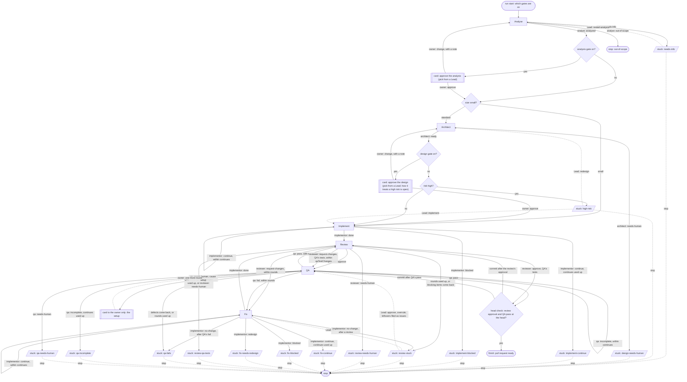

# The feature workflow

`workflows/feature.yaml` carries one issue from analysis to a pull request the way aw's single-issue flow does: analyse, an architect stage, implement, review, QA, fix, finish. The owner can approve the analysis or the design before work goes on, and routes follow conditions: a small change skips the architect, a high risk is stuck, and QA loops within its rounds. Every stage is a fleet ship, every result is checked, and every gate reaches the owner as a card.

Out of scope: several issues in one run, and a run overview page.

The design comes from Thomas's answers on #71. `workflows/bug-fix.yaml` stays at format version 1 and keeps working unchanged.

## Format version 2

`version: 2` turns on the keys below. `validate.py` accepts version 1 and version 2. The runner refuses a file whose version it cannot walk. The runner runs `validate.py` at the run's tag, so any file `validate.py` accepts is one the router can walk. A format change goes into both together.

### Routes: ordered rules

In version 2, each decision under a stage's `on` holds an ordered list of rules. The rules work like a `switch`: the first rule whose condition holds wins, and the last rule has no condition, so every decision has a route. The validator checks that the last rule has no `if` and is not an `ask:` rule.

```yaml
on:
  analyzed:
    - {go: ask:analysis}
    - {if: {size: small}, go: implement}
    - {go: architect}
```

An `ask:<gate>` rule has no `if`. When its gate is off for the run, the rule is skipped and the next rule decides; the file shows no condition for it.

A rule's `go` is one of these targets:

| Target | Effect |
| --- | --- |
| `<stage>` | Runs that stage. |
| `finish` | Runs the head check, then finishes the run. |
| `stuck:<situation>` | Puts the run in a stuck situation. The Lead decides first, and the owner gets a card for what the Lead cannot settle. |
| `ask:<gate>` | An approval gate: a card to the owner, never to the Lead. Skipped when the gate is off for the run. |
| `stop:<reason>` | Stops the run with that reason, which goes on the issue. |

### Conditions

A condition is either a test on a field of the stage's result, or a state condition.

- **A result field test** names the field and the value it must have, as in `if: {size: small}`, `if: {risk: high}` or `if: {cause: setup}`. The validator checks that the field belongs to the stage's result kind. In a gate answer, the field belongs to the result of the stage that asked.
- **A state condition** is written as a scalar, for example `if: qaTests`. The validator and router use these four names from aw:

| Condition | Holds when |
| --- | --- |
| `qaTests` | Review is checking QA's test commits. |
| `qaLoop` | QA finds a defect that has already come back through the fix loop. |
| `reviewLoop` | Review finds a blocker that has already come back through the fix loop. |
| `afterQaFail` | The fix follows a QA failure. |

### Decision words

A stage's decisions are the words in aw's role files, which stay as they are. The feature file uses aw's words:

| Role | Decisions |
| --- | --- |
| analyst | `analyzed`, `needs-info`, `out-of-scope` |
| architect | `ready`, `needs-human` |
| implementor (implement, fix) | `done`, `continue`, `blocked`, and for fix also `no-change` and `redesign` |
| reviewer | `approve`, `request-changes`, `needs-human` |
| qa | `pass`, `fail`, `needs-human`, `incomplete` |

A later version of the bug-fix file moves to these words too. Taking the words from the role files keeps a stage's result from failing its schema because the role text and the file disagree.

### Approval gates

The file declares its gates in their own section, `gates`. Each gate lists its answers. An answer names the stage it goes to, or holds ordered rules as a decision does:

```yaml
gates:
  analysis:
    approve:
      - {if: {size: small}, go: implement}
      - {go: architect}
    change: analyse
  design:
    approve: implement
    change: architect
```

Approving a small analysis goes straight to implement, as the analysis would without the gate.

A route reaches a gate with `ask:<gate>`. The run start message names which gates are on, as in `approvals: [analysis, design]`. A gate is off unless the start message turns it on.

A gate card goes to the owner and never to the Lead. The pick on the card still comes from a Lead: the Lead reads the analysis or the design and names a pick with its why. That Lead turn does not settle the gate; only the owner's answer does.

**Open: the risk on the design card.** With the design gate on, `ask:design` comes before the risk rule, so the owner sees the design card rather than a `high-risk` situation. How the card treats a high risk is not decided yet; the question is with Thomas.

### The owner's note

When the owner answers a card or a gate with a note, the note goes into the input of the next stage as an instruction. It wins over the stage's role text, as aw's decision files do. A "change" answer, for example, reaches the analyst with what to change.

### Stuck decisions

Each situation under `stuck` lists the decisions it allows. A decision that names a stage says where the run goes, as in aw's decisions table:

| Decision | Goes to |
| --- | --- |
| `restart-analysis` | `analyse` |
| `design`, `redesign` | `architect` |
| `implement` | `implement` |
| `fix` | `fix` |
| `qa` | `qa` |

```yaml
stuck:
  high-risk:
    - {implement: implement}
    - {redesign: architect}
    - stop
```

Write the five fixed decisions as scalars. They are `stop`, `ask`, `one-more-round` (one more round of the stage's budget), `split` (the change is split) and `approve`. `stop` is allowed in every situation.

`approve` overrules a stuck review. The blocking items left over are filed as issues, the pull request names them, and the run takes the review stage's existing `on.approve` route. In the feature workflow that route goes to QA for a code review and to `finish` for a review of QA's test commits, selected by `if: qaTests`.

The situations are aw's 17, each belonging to its stage, with the decisions aw allows:

| Stage | Situation | Decisions |
| --- | --- | --- |
| analyse | `needs-info` | `restart-analysis` |
| architect | `high-risk`, `design-needs-human` | `implement`, `redesign` |
| implement | `implement-blocked`, `implement-continue`, `implement-protected` | `implement`, `redesign` |
| fix | `fix-blocked`, `fix-continue`, `fix-needs-redesign`, `fix-protected` | `fix`, `redesign` |
| review | `review-stuck` | `fix`, `approve` |
| review | `review-qa-tests` | `qa`, `approve`, `fix` |
| review | `review-needs-human` | `fix`, `approve`, `redesign` |
| qa | `qa-fails` | `fix`, `redesign` |
| qa | `qa-needs-human`, `qa-incomplete`, `qa-protected` | `qa` |

The runner's own situations stay beside them: `rounds` (a budget used up), `loop` (a fix that changes nothing, or a blocking finding that comes back) and `silent` (a stage past its deadline after its retries).

Declare `qa-setup` under `stuck` for the owner-only setup card. The feature workflow gives it the fixed decisions `one-more-round` and `stop`.

### Budgets

Loops are budgeted by `rounds` on each stage, as in version 1, and the `one-more-round` decision adds one round. The feature file takes aw's numbers:

| Budget | Where | Number |
| --- | --- | --- |
| Review rounds | `review.rounds` | 3 |
| QA rounds | `qa.rounds` | 3 |
| Changes to QA's tests | `limits.qaTestChanges` | 2 |
| Continues | `limits.continues` | 3 |

A stage that needs more time answers `continue`. The runner then crews the same stage again in a fresh session, starting from the last pushed commit, within `continues`. QA's `incomplete` counts as its continue.

When present, `limits.continues` and `limits.qaTestChanges` are non-negative integers.

The change size limit is 400 lines (`limits.changeLines`), the same as bug-fix and aw. A change over the limit is stuck, and the card offers `split`.

### The head check

The file names the stages whose result must still hold at the current head: the review's approval and QA's pass. Before the run finishes, the runner checks that no commit landed after either of them. If one did, the run goes back to that stage. A late commit cannot go out unreviewed or untested.

**Open: four points of the head check.** They go to Thomas as questions and are not decided here:

1. How the file spells the head check.
2. Which stage the run goes back to when both the review's approval and QA's pass are stale.
3. What is compared with the pushed head: which commit stands for the review's approval and which for QA's pass.
4. Whether a stuck review that was overruled (`approve`) counts as the review's approval for the commit it overruled.

The version 2 validator accepts workflows without a head-check key while its spelling is open.

## Stages and roles

The stages run in aw's order: analyse, architect (skipped for a small change), implement, review, then fix and review again as often as needed, then QA, then fix, review and QA again as often as needed, and finally finish.

| Stage | Role | Result kind | Family | What it decides |
| --- | --- | --- | --- | --- |
| `analyse` | analyst | `analysis` | | Whether the issue is in scope, open questions, and `size` (`small` or `standard`) |
| `architect` | architect | `design` | any | The design, its changes, and `risk` |
| `implement` | implementor | `code` | | The change, test first |
| `review` | reviewer | `review` | `otherThan: implement` | Approve or request changes. Reviews the implementor's code, and QA's test commits in a round of their own |
| `qa` | qa | `qa` | `sameAs: implement` | Pass or fail on the repository's QA test projects |
| `fix` | implementor | `code` | `sameAs: implement` | Fixes what the review blocks or what QA found |

- **Architect and QA settings.** Both run on the large tier. The architect's deadline is 20 minutes and QA's 60 minutes. The architect loads software-development and domain-modelling; QA loads software-development and test-driven-development.
- **Size.** The analyst names `size: small` or `size: standard` by aw's rule. A change is small when it touches one or two files and adds no new component, contract or data change. With `small`, the analyst's plan is the plan and the run skips the architect. Nothing is built before the architect would run, so the runner has nothing to measure. The `size` check on implement still holds the line count afterwards.
- **Risk.** The architect names `risk` in its result. With `high`, the run is stuck on `high-risk`, and the Lead goes first.
- **Out of scope.** An analysis that finds the issue out of scope takes the route `stop:out-of-scope`.
- **QA's tests.** The repository names QA's test projects and the test paths in its profile: the profile has an optional `qaTests` list beside `tests` and `testPaths`. The QA stage says `tests: fromRepository` and runs the `qaTests` projects. No other stage runs them.
- **QA's check.** QA's check is `testsOnly`: it fails a QA result that changed anything outside the profile's `testPaths`. `redFirst` does not apply to QA's commits, which change only tests. The bug-fix file does not change.
- **QA's family.** QA runs in the implementor's family (`sameAs: implement`), so one review in the other family covers the code and QA's tests.
- **Reviewing QA's tests.** The same review stage reviews QA's test commits. The `qaTests` state routes its decisions: `request-changes` goes back to QA within `qaTestChanges`, and past it, or on `needs-human`, the run is stuck on `review-qa-tests`.
- **QA and the setup.** When QA cannot run because of the setup, it answers `needs-human` with `cause: setup`. The rule `{if: {cause: setup}, go: stuck:qa-setup}` sends one card naming the setup directly to the owner. A setup fault is fixed at its source, and the owner's `one-more-round` runs QA again. Any other `needs-human` is stuck on `qa-needs-human`.

## Result kinds

Version 2 adds two result kinds to the runner's schemas and one field to the analysis kind. [`result-fields.json`](result-fields.json) maps each result kind to the full list of its top-level fields, including shared fields. `validate.py` uses the list to check route field tests. The runner's schema tests compare the lists with the schema properties for each kind.

- `analysis` adds `size`: `small` or `standard`.
- `design` is new. It carries `risk` and the changes.
- `qa` is new. It carries `automation`, `defects`, `failed` and `cause` (`setup` or `product`), and uses the shared `commit` field for the tested ref.

## The flow of `workflows/feature.yaml`

The happy path is drawn in bold. Every other edge is an unhappy path: a gate, a stuck situation, a loop or a stop. A stuck situation goes to the Lead first, then to the owner as a card if the Lead cannot settle it. A Lead's or the owner's decision sends the run to the stage that the decision names under `stuck`.



What the edges mean:

1. **Happy path.** Analyse (standard size, no gates), then the architect (low or medium risk), implement, review approves, QA passes, the head check holds, finish.
2. **Small change.** `size: small` skips the architect, and the analyst's plan goes to implement.
3. **Gates.** With a gate on, the run waits for the owner's answer; with it off, its `ask:` rule is skipped. `approve` goes on: a small analysis straight to implement, a standard one to the architect, a design to implement. `change` with a note goes back to the stage that wrote the analysis or the design.
4. **High risk.** With the design gate off, the run is stuck on `high-risk`. The decisions name where it goes: implement anyway, redesign at the architect, or stop. With the design gate on, how the design card treats a high risk is open.
5. **Review loop.** `request-changes` goes to fix and back to review, within the review's `rounds`. Once the rounds are used up, or a blocking item comes back, the run is stuck on `review-stuck`. A stuck review can be overruled with `approve`: the leftover items are filed as issues, the pull request names them, and the run goes on.
6. **QA loop.** `fail` goes to fix, then review, then QA again, within QA's `rounds`. QA's own test commits go to the same review stage, where the `qaTests` state routes them: `request-changes` goes back to QA within `qaTestChanges`, and the approval goes on to the head check. A QA result that changed anything outside the test paths fails its `testsOnly` check. Defects that come back, or rounds used up, make the run stuck on `qa-fails`.
7. **More time.** `continue` crews the same stage again, fresh, from the last pushed commit, within the `continues` budget. QA's `incomplete` counts as its continue. Past the budget the run is stuck.
8. **Setup.** QA's `needs-human` with `cause: setup` is one card to the owner only, naming the setup. The owner's `one-more-round` runs QA again.
9. **Head check.** A commit after the review's approval sends the run back to review. A commit after QA's pass sends it back to QA. Four of its points are open (see [The head check](#the-head-check)).
10. **Stops.** `out-of-scope` stops the run with its reason. `stop` is a decision available in every stuck situation.
