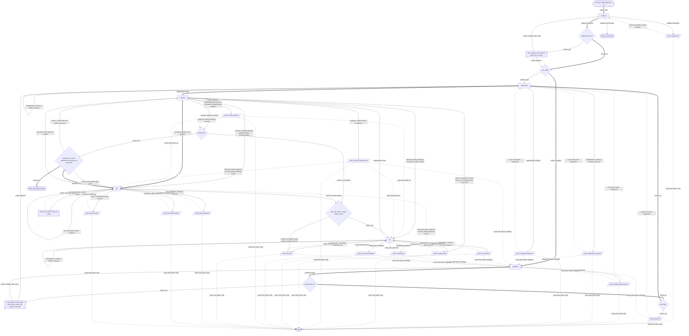

# The feature workflow

`workflows/feature.yaml` carries one issue from analysis to a pull request the way aw's single-issue flow does: analyse, an architect stage, implement, review, QA, fix, finish. The owner can approve the analysis or the design before work goes on, and routes follow conditions: a small change skips the architect, a high risk is stuck, and QA loops within its rounds. Every stage is a fleet ship, every result is checked, and every gate reaches the owner as a card.

Out of scope: several issues in one run, and a run overview page.

The design comes from Thomas's answers on #71. `workflows/bug-fix.yaml` stays at format version 1 and keeps working unchanged.

## Format version 2

`version: 2` turns on the keys below. `validate.py` accepts version 1 and version 2. The runner refuses a file whose version it cannot walk. The runner runs `validate.py` at the run's tag, so any file `validate.py` accepts is one the router can walk. A format change goes into both together.

### Routes: ordered rules

In version 2, each decision under a stage's `on` holds an ordered list of rules. The rules work like a `switch`: the first rule whose condition holds wins, and the last rule has no condition, so every decision has a route. The validator checks that the last rule has no `if` and is not an `ask:` rule.

```yaml
on:
  analyzed:
    - {go: ask:analysis}
    - {if: {size: small}, go: implement}
    - {go: architect}
```

An `ask:<gate>` rule has no `if`. When its gate is off for the run, the rule is skipped and the next rule decides; the file shows no condition for it.

A rule's `go` is one of these targets:

| Target | Effect |
| --- | --- |
| `<stage>` | Runs that stage. |
| `finish` | Runs the head check, then finishes the run. |
| `stuck:<situation>` | Puts the run in a stuck situation. The Lead decides first, and the owner gets a card for what the Lead cannot settle. |
| `ask:<gate>` | An approval gate: a card to the owner, never to the Lead. Skipped when the gate is off for the run. |
| `stop:<reason>` | Stops the run with that reason, which goes on the issue. |

### Conditions

A condition is either a test on a field of the stage's result, or a state condition.

- **A result field test** names the field and the value it must have, as in `if: {size: small}`, `if: {risk: high}` or `if: {cause: setup}`. The validator checks that the field belongs to the stage's result kind. `validate.py` reads each result kind's fields from its own small list in this repository, and the runner's schema tests check that list against the runner's schemas, so the two cannot drift apart.
- **A state condition** is a name from a short fixed list that the validator and the router both hold: a run's state, not a result. The list holds aw's four:

| Condition | Stage | Holds when |
| --- | --- | --- |
| `qaTests` | review | This review round is a round of QA's test commits, not of the implementor's code. |
| `reviewLoop` | review | A current blocking item repeats one from an earlier review round or is disputed by the implementor. Either case can lead to `review-stuck`. |
| `qaLoop` | qa | QA's defects in this round repeat defects from an earlier QA round. |
| `afterQaFail` | fix | The last verdict on the work, among the reviews, the gates and QA's fails, is QA's fail: the fix answers QA, not a review. |

A loop condition that holds names the repeated or disputed items that triggered it, and the stuck situation it leads to shows them.

Budgets are not conditions: the runner counts them, as [Budgets](#budgets) says.

### Decision words

A stage's decisions are the words in aw's role files, which stay as they are. The feature file uses aw's words:

| Role | Decisions |
| --- | --- |
| analyst | `analyzed`, `needs-info`, `out-of-scope` |
| architect | `ready`, `needs-human` |
| implementor (implement, fix) | `done`, `continue`, `blocked`, and for fix also `no-change` and `redesign` |
| reviewer | `approve`, `request-changes`, `needs-human` |
| qa | `pass`, `fail`, `needs-human`, `incomplete` |

A later version of the bug-fix file moves to these words too. Taking the words from the role files keeps a stage's result from failing its schema because the role text and the file disagree.

### Approval gates

The file declares its gates in their own section, `gates`. Each gate lists its answers. An answer names the stage it goes to, or holds ordered rules as a decision does:

```yaml
gates:
  analysis:
    approve:
      - {if: {size: small}, go: implement}
      - {go: architect}
    change: analyse
  design:
    approve: implement
    change: architect
```

Approving a small analysis goes straight to implement, as the analysis would without the gate.

Ordered rules on a gate answer follow from Q4 (an ordered list where the first rule that holds wins) applied to G2 (approving a small analysis goes to implement).

A route reaches a gate with `ask:<gate>`. The run start message names which gates are on, as in `approvals: [analysis, design]`. A gate is off unless the start message turns it on.

A gate card goes to the owner and never to the Lead. The pick on the card still comes from a Lead: the Lead reads the analysis or the design and names a pick with its why. That Lead turn does not settle the gate; only the owner's answer does.

The design card shows the architect's risk at the top, in bold when it is high.

### The owner's note

When the owner answers a card or a gate with a note, the note goes into the input of the next stage as an instruction. It wins over the stage's role text, as aw's decision files do. A "change" answer, for example, reaches the analyst with what to change.

### Stuck decisions

Each situation under `stuck` lists the decisions it allows. A decision that names a stage says where the run goes, as in aw's decisions table:

| Decision | Goes to |
| --- | --- |
| `restart-analysis` | `analyse` |
| `design`, `redesign` | `architect` |
| `implement` | `implement` |
| `fix` | `fix` |
| `qa` | `qa` |

```yaml
stuck:
  high-risk:
    - {implement: implement}
    - {redesign: architect}
    - stop
```

Five decisions are fixed and name no stage: `stop`, `ask`, `one-more-round` (one more round of the stage's budget), `split` (the change is split) and `approve`. `approve` overrules a stuck review: the blocking items left over are filed as issues, the pull request names them, and the run goes on. `stop` is allowed in every situation.

The situations are aw's 17, each belonging to its stage, with the decisions aw allows:

| Stage | Situation | Decisions |
| --- | --- | --- |
| analyse | `needs-info` | `restart-analysis` |
| architect | `high-risk`, `design-needs-human` | `implement`, `redesign` |
| implement | `implement-blocked`, `implement-continue`, `implement-protected` | `implement`, `redesign` |
| fix | `fix-blocked`, `fix-continue`, `fix-needs-redesign`, `fix-protected` | `fix`, `redesign` |
| review | `review-stuck` | `fix`, `approve` |
| review | `review-qa-tests` | `qa`, `approve`, `fix` |
| review | `review-needs-human` | `fix`, `approve`, `redesign` |
| qa | `qa-fails` | `fix`, `redesign` |
| qa | `qa-needs-human`, `qa-incomplete`, `qa-protected` | `qa` |

The runner's own situations stay beside them: `rounds` (a budget used up), `loop` (a fix that changes nothing, or a blocking finding that comes back) and `silent` (a stage past its deadline after its retries).

### Budgets

Loops are budgeted by `rounds` on each stage, as in version 1, and the `one-more-round` decision adds one round. The feature file takes aw's numbers:

| Budget | Where | Number |
| --- | --- | --- |
| Review rounds | `review.rounds` | 3 |
| QA rounds | `qa.rounds` | 3 |
| Changes to QA's tests | `limits.qaTestChanges` | 2 |
| Continues | `limits.continues` | 3 |

A stage that needs more time answers `continue`. The runner then crews the same stage again in a fresh session, starting from the last pushed commit, within `continues`. QA's `incomplete` counts as its continue.

A used-up budget leads to a stuck situation of its stage, as in aw. The runner counts each budget, and when a route would take one more round or run than its budget allows, the run is stuck on that situation instead:

| Budget | What counts | Used up |
| --- | --- | --- |
| `continues` | Implement's `continue`, in a row | `implement-continue` |
| `continues` | Fix's `continue`, in a row | `fix-continue` |
| `continues` | QA's `incomplete`, in a row | `qa-incomplete` |
| `review.rounds` | `request-changes` outside a `qaTests` round, back to fix | `review-stuck` |
| `qaTestChanges` | `request-changes` in a `qaTests` round, back to QA | `review-qa-tests` |
| `qa.rounds` | QA's `fail`, back to fix | `qa-fails` |

`continues` starts again from zero each time a stage starts from another stage; a stage that runs again on `continue` keeps it.

A check that finds changes a stage must undo gives the stage its one retry (`resultRetries`), with a note naming what to undo. When the retry fails too, the run is stuck on the stage's `<stage>-protected` situation, and the stage's next run gets that note. QA's `testsOnly` is such a check: a QA result that changed files outside the test paths twice is stuck on `qa-protected`.

The change size limit is 400 lines (`limits.changeLines`), the same as bug-fix and aw. A change over the limit is stuck, and the card offers `split`.

### The head check

The file names the stages whose result must still hold at the current head: the review's approval and QA's pass. Before the run finishes, the runner checks that no commit landed after either of them. If one did, the run goes back to that stage. A late commit cannot go out unreviewed or untested.

The file spells the check `headCheck: [review, qa]`, and `validate.py` checks that each name in it is a stage of the file. The runner compares the commit the reviewer approved and the ref QA tested, the QA result's `commit`, with the run branch's pushed head on origin. It returns to the first stale stage in the list, so review comes first when both are stale. Overruling a stuck review counts as approval of the commit it overruled. A later commit makes that approval stale.

## Stages and roles

The stages run in aw's order: analyse, architect (skipped for a small change), implement, review, then fix and review again as often as needed, then QA, then fix, review and QA again as often as needed, and finally finish.

| Stage | Role | Result kind | Family | What it decides |
| --- | --- | --- | --- | --- |
| `analyse` | analyst | `analysis` | | Whether the issue is in scope, open questions, and `size` (`small` or `standard`) |
| `architect` | architect | `design` | any | The design, its changes, and `risk` |
| `implement` | implementor | `code` | | The change, test first |
| `review` | reviewer | `review` | `otherThan: implement` | Approve or request changes. Reviews the implementor's code, and QA's test commits in a round of their own |
| `qa` | qa | `qa` | `sameAs: implement` | Pass or fail on the repository's QA test projects |
| `fix` | implementor | `code` | `sameAs: implement` | Fixes what the review blocks or what QA found |

- **Architect and QA settings.** Both run on the large tier. The architect's deadline is 20 minutes and QA's 60 minutes. The architect loads software-development and domain-modelling; QA loads software-development and test-driven-development.
- **Size.** The analyst names `size: small` or `size: standard` by aw's rule. A change is small when it touches one or two files and adds no new component, contract or data change. With `small`, the analyst's plan is the plan and the run skips the architect. Nothing is built before the architect would run, so the runner has nothing to measure. The `size` check on implement still holds the line count afterwards.
- **Risk.** The architect names `risk` in its result. How it routes is under [Risk routing](#risk-routing).
- **Out of scope.** An analysis that finds the issue out of scope takes the route `stop:out-of-scope`.
- **QA's tests.** The repository names QA's test projects and the test paths in its profile: the profile has an optional `qaTests` list beside `tests` and `testPaths`. The QA stage says `tests: fromRepository` and runs the `qaTests` projects. No other stage runs them.
- **QA's check.** QA's check is `testsOnly`: it fails a QA result that changed anything outside the profile's `testPaths`. `redFirst` does not apply to QA's commits, which change only tests. The bug-fix file does not change.
- **QA's family.** QA runs in the implementor's family (`sameAs: implement`), so the reviewer in the other family covers both implementation and QA's test commits.
- **Reviewing QA's tests.** This feature design requires the runner to hold every QA result with test commits, including a fail, and run a separate round of the same review stage. Only after that round approves does the runner apply QA's routes. The runner handles this step automatically. In aw, QA test review begins after QA passes on the current head. On a fail, aw checks for a defect loop or an exhausted budget and otherwise routes to fix. The `qaTests` state routes the review's decisions: `approve` lets QA's decision route the run as it would without test commits, `request-changes` goes back to QA within `qaTestChanges`, and past it, or on `needs-human`, the run is stuck on `review-qa-tests`.
- **QA and the setup.** When QA cannot run because of the setup, it answers `needs-human` with `cause: setup`. The rule `if: {cause: setup}` routes it to a setup card: one card to the owner only, never to the Lead, naming the setup, the same way a hook refusal does. A setup fault is fixed at its source, and the owner's `one-more-round` runs QA again. Any other `needs-human` is stuck on `qa-needs-human`.

### Risk routing

The architect names `risk` in its result. With the design gate off, `risk: high` makes the run stuck on `high-risk`, and the Lead goes first; its decisions are `implement`, `redesign` (back to the architect) and `stop`.

With the design gate on, `ask:design` comes before the risk rule. The owner's design card shows the architect's risk at the top and puts high risk in bold. The owner's approval settles the risk and sends the run to implement. A change answer sends the run back to the architect with the owner's note.

## Result kinds

Version 2 adds two result kinds to the runner's schemas and one field to the analysis kind. A route reads these fields, so each field is in the list `validate.py` checks against, and the runner's schema tests keep that list equal to the schemas.

- `analysis` adds `size`: `small` or `standard`.
- `design` is new. It carries `risk` and the changes.
- `qa` is new. It carries the defect ids, the ref the tests are on, what failed, and the cause (`setup` or `product`). The ref QA tested is the common `commit`: the run branch head when QA finishes, its own test commit when it made one, as aw's QA result names it. A pass or a fail without it fails its result check. `automation` names the branch and commit of tests kept in another repository, or `none`.

## The flow of `workflows/feature.yaml`

Every edge names who takes it: a stage's role by its decision (`analyst:`, `architect:`, `implementor:`, `reviewer:`, `qa:`), the `runner:` for an automatic route, the `owner:` for a card, and `Lead, else owner:` for a stuck situation. A stuck situation goes to the Lead first, then to the owner as a card if the Lead cannot settle it; either one's decision sends the run to the stage that the decision names under `stuck`. The happy path is drawn in bold (thick edges). Every other edge is an unhappy path: a gate, a stuck situation, a loop or a stop. The review's routes are ordered, the first that holds wins, and each names whether the `qaTests` state holds.



What the edges mean:

1. **Happy path.** Analyse (standard size, no gates), then the architect (low or medium risk), implement, review approves, QA passes without test commits, the head check holds, finish. These edges are the thick ones.
2. **Small change.** `size: small` skips the architect, and the analyst's plan goes to implement.
3. **Gates.** With a gate on, the run waits for the owner's answer; with it off, its `ask:` rule is skipped. `approve` goes on: a small analysis straight to implement, a standard one to the architect, a design to implement. `change` with a note goes back to the stage that wrote the analysis or the design.
4. **High risk.** As [Risk routing](#risk-routing) says.
5. **Review loop.** `request-changes` goes to fix and back to review, within the review's `rounds`. Once the rounds are used up, or a blocking item comes back, the run is stuck on `review-stuck`. A stuck review can be overruled with `approve`: the leftover items are filed as issues, the pull request names them, and the run goes on.
6. **QA loop.** `fail` goes to fix, then review, then QA again, within QA's `rounds`. Every QA result with test commits, a pass or a fail, goes to its own review round first, where the `qaTests` state routes it: `request-changes` goes back to QA within `qaTestChanges`, and the approval lets QA's decision go on, a pass to the head check and a fail as a fail without test commits would. No route takes QA's test commits to the head check or to fix unreviewed. A QA result that changed anything outside the test paths fails its `testsOnly` check. Defects that come back, or rounds used up, make the run stuck on `qa-fails`.
7. **More time.** `continue` crews the same stage again, fresh, from the last pushed commit, within the `continues` budget. QA's `incomplete` counts as its continue. Past the budget the run is stuck on `implement-continue`, `fix-continue` or `qa-incomplete`.
8. **Setup.** QA's `needs-human` with `cause: setup` is one card to the owner only, naming the setup. The owner's `one-more-round` runs QA again.
9. **Head check.** The run goes back to the first stale stage in `headCheck`. Review comes first when both results are stale. See [The head check](#the-head-check) for the refs it compares.
10. **Stuck exits.** Each stuck situation shows every decision its row in the situations table allows, and `stop`. The Lead decides first; what the Lead cannot settle goes to the owner as a card, who picks from the same decisions.
11. **Stops.** `out-of-scope` stops the run with its reason. `stop` is a decision available in every stuck situation.
