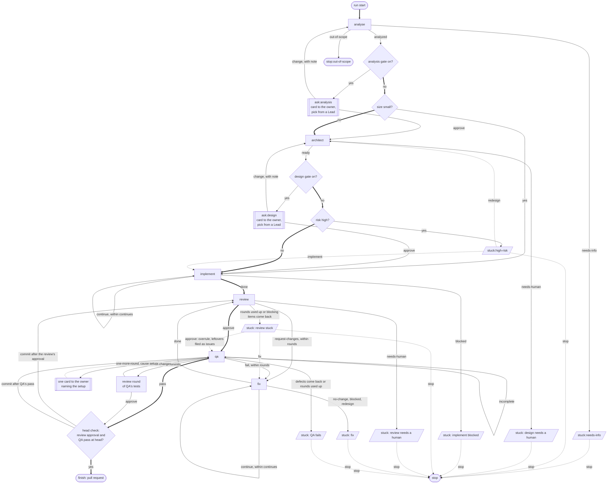

# The feature workflow

`workflows/feature.yaml` carries one issue from analysis to a pull request the way aw's single-issue flow does: analyse, an architect stage, implement, review, QA, fix, finish. The owner can approve the analysis or the design before work goes on, and routes follow conditions: a small change skips the architect, a high risk is stuck, and QA loops within its rounds. Every stage is a fleet ship, every result is checked, and every gate reaches the owner as a card.

Out of scope: several issues in one run, and a run overview page.

The design comes from Thomas's answers on #71. `workflows/bug-fix.yaml` stays at format version 1 and keeps working unchanged.

## Format version 2

`version: 2` turns on the keys below. `validate.py` accepts version 1 and version 2. The runner refuses a file whose version it cannot walk. The runner runs `validate.py` at the run's tag, so any file `validate.py` accepts is one the router can walk. A format change goes into both together.

### Routes: ordered rules

In version 2, each decision under a stage's `on` holds an ordered list of rules. The rules work like a `switch`: the first rule whose condition holds wins, and the last rule has no condition, so every decision has a route. The validator checks that the last rule has no `if`.

```yaml
on:
  analyzed:
    - {if: {size: small}, go: implement}
    - {go: architect}
```

A rule's `go` is one of these targets:

| Target | Effect |
| --- | --- |
| `<stage>` | Runs that stage. |
| `finish` | Runs the head check, then finishes the run. |
| `stuck:<situation>` | Puts the run in a stuck situation. The Lead decides first, and the owner gets a card for what the Lead cannot settle. |
| `ask:<gate>` | An approval gate: a card to the owner, never to the Lead. |
| `stop:<reason>` | Stops the run with that reason, which goes on the issue. |

### Conditions

A condition is either a test on a field of the stage's result, or a state condition.

- **A result field test** names the field and the value it must have, as in `if: {size: small}` or `if: {risk: high}`. The validator checks that the field is in the schema of the stage's result kind.
- **A state condition** is a name from a short fixed list that the validator and the router both hold. These conditions cover budgets, loops and approvals: a run's state, not a result.

### Decision words

A stage's decisions are the words in aw's role files, which stay as they are. The feature file uses aw's words:

| Role | Decisions |
| --- | --- |
| analyst | `analyzed`, `needs-info`, `out-of-scope` |
| architect | `ready`, `needs-human` |
| implementor (implement, fix) | `done`, `continue`, `blocked`, and for fix also `no-change` and `redesign` |
| reviewer | `approve`, `request-changes`, `needs-human` |
| qa | `pass`, `fail`, `needs-human`, `incomplete` |

A later version of the bug-fix file moves to these words too. Taking the words from the role files keeps a stage's result from failing its schema because the role text and the file disagree.

### Approval gates

The file declares its gates in their own section, `gates`. Each gate lists its answers, and each answer names the stage it goes to:

```yaml
gates:
  analysis:
    approve: architect
    change: analyse
  design:
    approve: implement
    change: architect
```

A route reaches a gate with `ask:<gate>`. The run start message names which gates are on, as in `approvals: [analysis, design]`. A gate is off unless the start message turns it on.

A gate card goes to the owner and never to the Lead. The pick on the card still comes from a Lead: the Lead reads the analysis or the design and names a pick with its why. That Lead turn does not settle the gate; only the owner's answer does.

### The owner's note

When the owner answers a card or a gate with a note, the note goes into the input of the next stage as an instruction. It wins over the stage's role text, as aw's decision files do. A "change" answer, for example, reaches the analyst with what to change.

### Stuck decisions

Each situation under `stuck` lists the decisions it allows, and each decision names the stage the run goes to. This is aw's decisions table, written per situation:

```yaml
stuck:
  high-risk:
    - {implement: implement}
    - {redesign: architect}
    - stop
```

`stop` and `ask` stay fixed and name no stage. Overruling a stuck review is allowed: that is aw's `approve`. The blocking items left over are filed as issues, and the pull request names them.

### Budgets

Loops are budgeted by `rounds` on each stage, as in version 1. Review and QA each have their own `rounds`, and the `one-more-round` decision adds one round.

A stage that needs more time answers `continue`. The runner then crews the same stage again in a fresh session, starting from the last pushed commit. A `continues` budget limits how often that can happen.

The change size limit is 400 lines (`limits.changeLines`), the same as bug-fix and aw. A change over the limit is stuck, and the card offers `split`.

### The head check

The file names the stages whose result must still hold at the current head: the review's approval and QA's pass. Before the run finishes, the runner checks that no commit landed after either of them. If one did, the run goes back to that stage. A late commit cannot go out unreviewed or untested.

## Stages and roles

The stages run in aw's order: analyse, architect (skipped for a small change), implement, review, then fix and review again as often as needed, then QA, then fix, review and QA again as often as needed, and finally finish.

| Stage | Role | Result kind | Family | What it decides |
| --- | --- | --- | --- | --- |
| `analyse` | analyst | `analysis` | | Whether the issue is in scope, open questions, and `size` (`small` or `standard`) |
| `architect` | architect | `design` | | The design, its changes, and `risk` |
| `implement` | implementor | `code` | | The change, test first |
| `review` | reviewer | `review` | `otherThan: implement` | Approve or request changes. Reviews the implementor's code, and QA's test commits in a round of their own |
| `qa` | qa | `qa` | `sameAs: implement` | Pass or fail on the end-to-end projects the file names for it |
| `fix` | implementor | `code` | `sameAs: implement` | Fixes what the review blocks or what QA found |

- **Size.** The analyst names `size: small` or `size: standard` by aw's rule. A change is small when it touches one or two files and adds no new component, contract or data change. With `small`, the analyst's plan is the plan and the run skips the architect. Nothing is built before the architect would run, so the runner has nothing to measure. The `size` check on implement still holds the line count afterwards.
- **Risk.** The architect names `risk` in its result. With `high`, the run is stuck on `high-risk`, and the Lead goes first.
- **Out of scope.** An analysis that finds the issue out of scope takes the route `stop:out-of-scope`.
- **QA's limits.** QA is the only stage that runs the end-to-end projects the file names for it. A new check fails a QA result that changed anything outside the test paths. `redFirst` does not apply to QA's commits, which change only tests.
- **QA's family.** QA runs in the implementor's family (`sameAs: implement`), so one review in the other family covers the code and QA's tests.
- **QA and the setup.** When QA cannot run because of the setup, it reports `blocked` with the cause. That goes to the owner as a single card naming the setup, the same way a hook refusal does. A setup fault is fixed at its source.

## Result kinds

Version 2 adds two result kinds to the runner's schemas and one field to the analysis kind. A route reads these fields, so each field is in a schema the validator can check against.

- `analysis` adds `size`: `small` or `standard`.
- `design` is new. It carries `risk` and the changes.
- `qa` is new. It carries the defect ids, the ref the tests are on, what failed, and the cause (`setup` or `product`).

## The flow of `workflows/feature.yaml`

The happy path is drawn in bold. Every other edge is an unhappy path: a gate, a stuck situation, a loop or a stop. A stuck situation goes to the Lead first, then to the owner as a card if the Lead cannot settle it. A Lead's or the owner's decision sends the run to the stage that the decision names under `stuck`.



What the edges mean:

1. **Happy path.** Analyse (standard size, no gates), then the architect (low or medium risk), implement, review approves, QA passes, the head check holds, finish.
2. **Small change.** `size: small` skips the architect, and the analyst's plan goes to implement.
3. **Gates.** With a gate on, the run waits for the owner's answer. `approve` goes on, and `change` with a note goes back to the stage that wrote the analysis or the design.
4. **High risk.** The run is stuck on `high-risk`. The decisions name where it goes: implement anyway, redesign at the architect, or stop.
5. **Review loop.** `request-changes` goes to fix and back to review, within the review's `rounds`. Once the rounds are used up, or a blocking item comes back, the run is stuck. A stuck review can be overruled: the leftover items are filed as issues, the pull request names them, and the run goes on.
6. **QA loop.** `fail` goes to fix, then review, then QA again, within QA's `rounds`. QA's own test commits get a review round of their own: its changes go back to QA, and its approval goes on to the head check. A QA result that changed anything outside the test paths fails its checks. Defects that come back, or rounds used up, make the run stuck.
7. **More time.** `continue` crews the same stage again, fresh, from the last pushed commit, within the `continues` budget.
8. **Setup.** QA `blocked` with cause `setup` is one card to the owner naming the setup.
9. **Head check.** A commit after the review's approval sends the run back to review. A commit after QA's pass sends it back to QA.
10. **Stops.** `out-of-scope` stops the run with its reason. `stop` is a decision available in every stuck situation.
